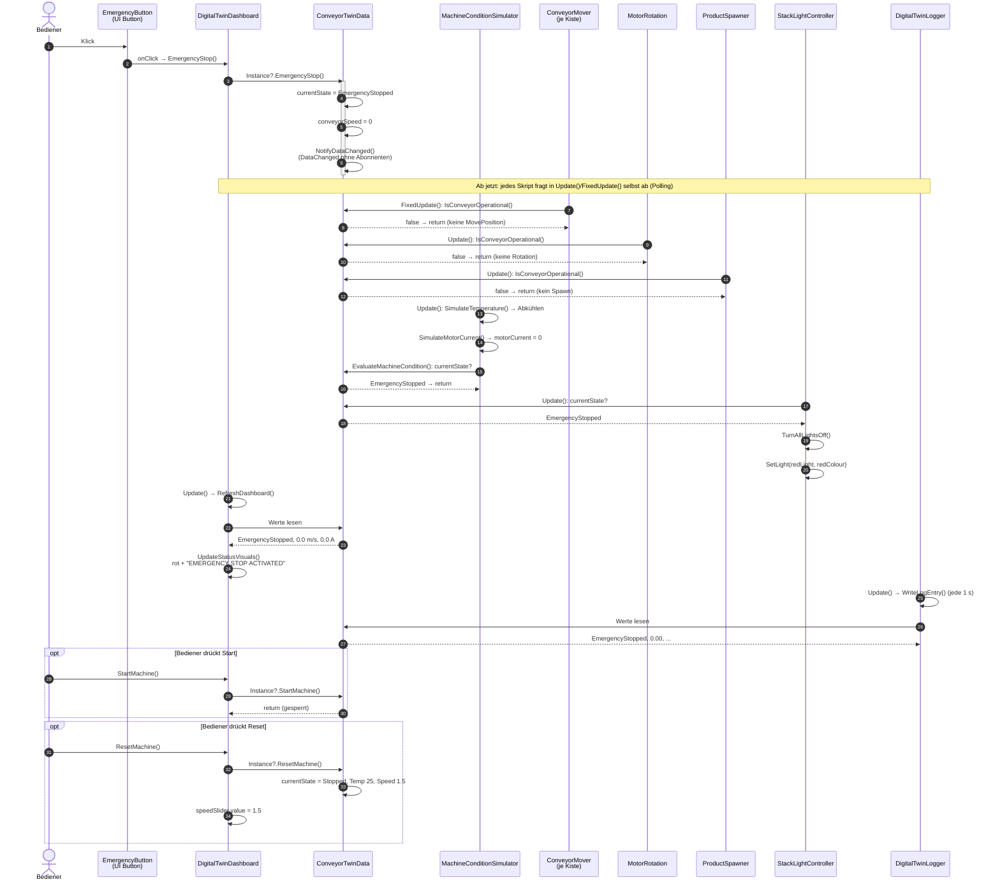

# Ablauf 2C – Not-Halt auslösen

**Projekt:** IndustrialConveyorDigitalTwin (Unity 6000.3.24f1)
**Szene:** `Assets/Scenes/ConveyorDigitalTwin.unity`
Alle Zeilennummern, Methodennamen und Werte wurden direkt im Quellcode und in der Szenendatei geprüft.

---

## 0. Ganz kurz (für die Einleitung im Video)

Der Bediener drückt den **EMERGENCY**-Button. Daraufhin passiert Folgendes:

1. Unity ruft `DigitalTwinDashboard.EmergencyStop()` auf.
2. Diese Methode leitet den Aufruf an `ConveyorTwinData.EmergencyStop()` weiter.
3. Dort wird der Zustand auf **`EmergencyStopped`** und die Geschwindigkeit auf **0** gesetzt.
4. Alle anderen Skripte fragen diesen Zustand jeden Frame selbst ab (Polling) und reagieren darauf:
   - Die Kisten bleiben stehen.
   - Der Motor hört auf zu drehen.
   - Es werden keine neuen Kisten erzeugt.
   - Der Strom fällt auf 0 und der Motor kühlt ab.
   - Die Ampel wird rot, das Dashboard zeigt „EMERGENCY STOP ACTIVATED“.
   - Der Logger schreibt den neuen Zustand in die CSV.
5. **Start** und **Stop** sind jetzt gesperrt. Nur **Reset** hebt den Not-Halt auf, und danach muss man noch zusätzlich **Start** drücken.

---

## 1. Beteiligte Dateien, Objekte und Methoden

| Skript (Datei) | Hängt in der Szene an GameObject | Rolle im Not-Halt | Relevante Methoden (Zeile) |
|---|---|---|---|
| *(Unity UI)* `Button` | `EmergencyButton` | Erkennt den Klick und löst `onClick` aus | `onClick` → ruft `DigitalTwinDashboard.EmergencyStop` (im Inspector verknüpft) |
| `Assets/Scripts/UI/DigitalTwinDashboard.cs` | `Canvas` | Nimmt den Klick an, leitet ihn weiter und zeigt danach den Status an | `EmergencyStop()` (114), `Update()` (37), `RefreshDashboard()` (42), `UpdateStatusVisuals()` (69, Case EmergencyStopped: 91–94) |
| `Assets/Scripts/Core/ConveyorTwinData.cs` | `DigitalTwinManager` | **Zentrale Steuerung und Datenspeicher.** Ändert hier den Zustand. | `EmergencyStop()` (79–84), `IsConveyorOperational()` (50–54), `StartMachine()` (56–66), `StopMachine()` (68–77), `ResetMachine()` (86–94), `NotifyDataChanged()` (108–111) |
| `Assets/Scripts/UI/StackLightController.cs` | `MachineStackLight` | Ampel: schaltet auf Rot | `Update()` (17), `TurnAllLightsOff()` (43), `SetLight()` (50) |
| `Assets/Scripts/Equipment/ConveyorMover.cs` | jede Kiste (Prefab `ProductBox`) | Bewegt die Kisten, hört dann auf | `FixedUpdate()` (19–25) |
| `Assets/Scripts/Equipment/MotorRotation.cs` | `Motor` | Dreht das Motormodell, hört dann auf | `Update()` (7–13) |
| `Assets/Scripts/Equipment/ProductSpawner.cs` | `ProductSpawner` | Erzeugt keine Kisten mehr | `Update()` (15–20) |
| `Assets/Scripts/Equipment/MachineConditionSimulator.cs` | `DigitalTwinManager` | Strom auf 0, Motor kühlt ab, **überschreibt den Not-Halt nicht** | `Update()` (14), `SimulateTemperature()` (28), `SimulateMotorCurrent()` (47), `EvaluateMachineCondition()` (61–66) |
| `Assets/Scripts/Logging/DigitalTwinLogger.cs` | `DigitalTwinManager` | Schreibt den Not-Halt ins Protokoll | `Update()` (32), `WriteLogEntry()` (45) |

**Wichtig für die Abnahme:** Die **Pfeile mit Methodenaufrufen** gibt es nur zwischen Button → Dashboard → ConveyorTwinData. Alle anderen Skripte werden **nicht aufgerufen**. Sie **lesen** den Zustand selbst in ihrem `Update()`/`FixedUpdate()`.

---

## 2. Der Code – Schritt für Schritt

### Schritt 1 – Button-Klick → `DigitalTwinDashboard.EmergencyStop()`

In der Szene ist beim `EmergencyButton` unter **OnClick()** eingetragen: Objekt `Canvas`, Funktion `DigitalTwinDashboard.EmergencyStop`. Diese Verknüpfung wurde im Inspector gemacht, nicht im Code. Deshalb steht im Code nirgends `button.onClick.AddListener(...)`.

```csharp
// DigitalTwinDashboard.cs, Zeile 114
public void EmergencyStop()
{
    ConveyorTwinData.Instance?.EmergencyStop();
}
```

- `ConveyorTwinData.Instance` ist das **Singleton**, also die eine zentrale Datenquelle.
- `?.` bedeutet: nur aufrufen, wenn `Instance` nicht `null` ist. Sonst passiert nichts und es gibt keinen Absturz.
- Die Methode muss **`public`** sein, sonst kann man sie im Inspector beim Button nicht auswählen.

### Schritt 2 – `ConveyorTwinData.EmergencyStop()`: Hier passiert der eigentliche Not-Halt

```csharp
// ConveyorTwinData.cs, Zeile 79–84
public void EmergencyStop()
{
    currentState = MachineState.EmergencyStopped;
    conveyorSpeed = 0f;
    NotifyDataChanged();
}
```

1. `currentState = MachineState.EmergencyStopped;` ist der **wichtigste** Teil, denn alle anderen Skripte reagieren auf diesen Zustand.
2. `conveyorSpeed = 0f;` setzt den Sollwert der Geschwindigkeit auf 0. Das ist eine zweite Absicherung, und Dashboard und Log zeigen danach 0.0 m/s.
3. `NotifyDataChanged();` löst das C#-Event `DataChanged` aus (`DataChanged?.Invoke();`, Zeile 110).
   **Achtung:** Im ganzen Projekt meldet sich **kein** Skript bei diesem Event an (es gibt kein `DataChanged +=`). Der Aufruf bewirkt also im Moment **nichts**. Das Event ist vorbereitet, wird aber nicht benutzt.

Auffällig: Am Anfang der Methode steht **keine `if`-Prüfung**. Der Not-Halt funktioniert also in **jedem** Zustand, auch bei Stopped, Warning oder Fault. Warum das so sein muss, steht in Kapitel 4.

### Schritt 3 – Alle anderen reagieren über `IsConveyorOperational()`

```csharp
// ConveyorTwinData.cs, Zeile 50–54
public bool IsConveyorOperational()
{
    return currentState == MachineState.Running ||
           currentState == MachineState.Warning;
}
```

Ab jetzt liefert diese Methode **`false`**, weil `EmergencyStopped` weder `Running` noch `Warning` ist.

#### 3a – Kisten bleiben stehen (`ConveyorMover.FixedUpdate`, alle 0,02 s)

```csharp
if (productRigidbody == null ||
    ConveyorTwinData.Instance == null ||
    !ConveyorTwinData.Instance.IsConveyorOperational())
{
    return;              // ← wird jetzt immer ausgeführt
}
// ...MovePosition(...) wird nicht mehr erreicht
```

Die Kisten werden nur durch `MovePosition` vorwärtsgeschoben. Ohne diesen Aufruf bleiben sie liegen. Sie werden nicht gelöscht.

#### 3b – Motor hört auf zu drehen (`MotorRotation.Update`)

`if (data == null || !data.IsConveyorOperational()) return;` → `transform.Rotate(...)` wird nicht mehr ausgeführt.

#### 3c – Keine neuen Kisten (`ProductSpawner.Update`)

`!IsConveyorOperational()` → `return;`. Der `spawnTimer` zählt nicht weiter, wird aber auch **nicht auf 0 gesetzt**. Nach Reset und Start läuft er also dort weiter, wo er stehen geblieben ist.

#### 3d – Zustandsüberwachung (`MachineConditionSimulator.Update`)

Hier werden nacheinander drei Methoden aufgerufen:

- **`SimulateTemperature`**: nicht in Betrieb → `Mathf.MoveTowards(temp, 25, coolingRate * Time.deltaTime)`. In der Szene ist `coolingRate = 2`, der Motor kühlt also mit 2 °C pro Sekunde Richtung 25 °C ab.
- **`SimulateMotorCurrent`**: nicht in Betrieb → `motorCurrent = 0f`.
- **`EvaluateMachineCondition`**:
  ```csharp
  if (data.currentState == ConveyorTwinData.MachineState.EmergencyStopped)
  {
      return;   // Zeile 63–66
  }
  ```
  Damit wird die ganze Temperaturauswertung **übersprungen**. Ohne diese Zeile könnte der Simulator den Not-Halt überschreiben: Liegt die Temperatur gerade bei ≥ 80 °C, würde er `currentState = Fault` setzen (Zeile 71).

#### 3e – Ampel wird rot (`StackLightController.Update`)

```csharp
TurnAllLightsOff();
switch (ConveyorTwinData.Instance.currentState)
{
    ...
    case ConveyorTwinData.MachineState.Fault:
    case ConveyorTwinData.MachineState.EmergencyStopped:
        SetLight(redLight, redColour);
        break;
}
```

`SetLight` setzt die Farbe des Materials und schaltet zusätzlich Emission ein (`_EMISSION`, `_EmissionColor = colour * 2f`), damit die Lampe leuchtet.

#### 3f – Dashboard zeigt den Not-Halt (`DigitalTwinDashboard.Update` → `RefreshDashboard` → `UpdateStatusVisuals`)

- `STATE: EmergencyStopped`
- `SPEED: 0.0 m/s`
- `MOTOR CURRENT: 0.0 A`
- Temperatur sinkt sichtbar
- `statusIndicator.color = faultColour` (rot), `alarmText.text = "EMERGENCY STOP ACTIVATED"` (Zeile 91–94)

#### 3g – Protokoll (`DigitalTwinLogger.Update` → `WriteLogEntry`, jede Sekunde)

Die nächste CSV-Zeile enthält zum Beispiel `...,EmergencyStopped,0.00,<Temp>,0.00,<Count>,...`. So ist der Not-Halt **nachträglich** mit Zeitstempel nachvollziehbar.

### Schritt 4 – Gesperrte Funktionen während des Not-Halts

```csharp
// StartMachine(), Zeile 58–62
if (currentState == MachineState.Fault ||
    currentState == MachineState.EmergencyStopped)
{
    return;      // Start hat keine Wirkung
}

// StopMachine(), Zeile 70–73
if (currentState == MachineState.EmergencyStopped)
{
    return;      // Stop hat keine Wirkung
}
```

### Schritt 5 – Den Not-Halt wieder aufheben (Quittieren)

```csharp
// ConveyorTwinData.cs, Zeile 86–94
public void ResetMachine()
{
    currentState = MachineState.Stopped;   // NICHT Running!
    motorTemperature = 25f;
    conveyorSpeed = 1.5f;
    entrySensorActive = false;
    exitSensorActive = false;
    NotifyDataChanged();
}
```

`DigitalTwinDashboard.ResetMachine()` setzt danach noch `speedSlider.value = 1.5`, damit der Slider wieder zum tatsächlichen Wert passt. Die Anlage steht jetzt auf **Stopped**. Weiter geht es erst, wenn jemand bewusst **Start** drückt.

---

## 3. Zeitliche Reihenfolge – wann genau passiert was?

| Zeitpunkt | Was passiert | Wo |
|---|---|---|
| **t = 0, Klick** | Das EventSystem (Input System UI Module) erkennt den Mausklick auf `EmergencyButton`, der Button löst `onClick` aus | Unity UI |
| sofort, im selben Aufruf | `DigitalTwinDashboard.EmergencyStop()` → `ConveyorTwinData.Instance?.EmergencyStop()` | Canvas → DigitalTwinManager |
| sofort, im selben Aufruf | `currentState = EmergencyStopped`, `conveyorSpeed = 0`, `NotifyDataChanged()` (ohne Empfänger) | ConveyorTwinData |
| **im selben oder spätestens im nächsten Frame** (~16 ms bei 60 FPS) | Jedes `Update()` liest den neuen Zustand: Dashboard-Text/Farbe, Ampel rot, Motor steht, Spawner pausiert, Strom = 0, Abkühlung beginnt | alle Update-Skripte |
| **beim nächsten Physik-Schritt** (spätestens nach 0,02 s, `Fixed Timestep = 0.02`) | `ConveyorMover.FixedUpdate()` bricht ab, die Kisten bewegen sich nicht mehr | jede Kiste |
| **innerhalb von ≤ 1 s** | Der Logger schreibt eine Zeile mit `EmergencyStopped` | DigitalTwinLogger |
| **danach, jede Sekunde** | Die Temperatur sinkt um 2 °C/s bis 25 °C, der Logger schreibt weiter | MachineConditionSimulator, Logger |
| **Bediener drückt Start/Stop** | `return;`, nichts passiert | ConveyorTwinData |
| **Bediener drückt Reset** | Zustand = Stopped, Temperatur 25 °C, Geschwindigkeit 1,5, Sensoren CLEAR, Ampel aus, „SYSTEM STOPPED“ | ConveyorTwinData, Dashboard |
| **Bediener drückt Start** | Zustand = Running, Band läuft wieder | ConveyorTwinData |

**Warum „im selben *oder* im nächsten Frame“?** Unity ruft die `Update()`-Methoden aller Skripte nacheinander auf. Welches Skript zuerst drankommt, ist nicht festgelegt, und im Projekt ist auch keine **Script Execution Order** eingestellt. Kommt ein Skript im aktuellen Frame vor dem EventSystem dran, sieht es den neuen Zustand erst im nächsten Frame. Für das Auge macht das keinen Unterschied.

---

## 4. Die „Warum?“-Kette

### Warum gibt es überhaupt einen Not-Halt?
Weil eine echte Förderanlage Menschen verletzen kann: Hände können eingezogen oder Teile eingeklemmt werden. Jede Maschine braucht deshalb eine Möglichkeit, **sofort und in jedem Zustand** gefährliche Bewegungen zu stoppen (Maschinenrichtlinie, Norm EN ISO 13850). Ein digitaler Zwilling soll genau dieses Verhalten nachbilden und testbar machen.

### Warum braucht man im Not-Halt einen eigenen Zustand und nimmt nicht einfach „Stopped“?
Weil sich die beiden Zustände unterschiedlich verhalten müssen:
- **Stopped** ist ein normales Betriebsende. Man darf jederzeit wieder **Start** drücken.
- **EmergencyStopped** ist eine Sicherheitsreaktion. Hier darf man **nicht** einfach wieder starten. Erst muss jemand prüfen, ob die Gefahr vorbei ist, und das **quittieren** (Reset).

Mit nur einem Zustand könnte der Code diese beiden Fälle nicht unterscheiden.

### Warum hat `EmergencyStop()` keine `if`-Abfrage, `StartMachine()` aber schon?
Ein Not-Halt muss **immer** funktionieren, egal ob die Anlage gerade läuft, warnt oder eine Störung hat. Jede Bedingung davor wäre eine Situation, in der der Not-Halt versagen könnte. Beim Start ist es umgekehrt: Er darf nur unter bestimmten Bedingungen funktionieren, deshalb wird dort geprüft.

### Warum wird zusätzlich `conveyorSpeed = 0` gesetzt? Der Zustand reicht doch schon.
- **Doppelte Absicherung:** Würde ein Skript (jetzt oder später) nur die Geschwindigkeit verwenden und den Zustand nicht prüfen, bewegt sich trotzdem nichts.
- **Anzeige und Protokoll:** Dashboard und CSV zeigen 0.00 m/s. Das entspricht dem realen Verhalten, bei dem der Antrieb auf Drehzahl 0 geht.
- **Vergleich mit der Realität:** Auch eine echte Steuerung setzt den Sollwert auf 0 und schaltet zusätzlich den Antrieb momentfrei (*Safe Torque Off*).

### Warum ist Start im Not-Halt gesperrt?
Weil eine Anlage nach einem Not-Halt **nie von selbst oder mit einem Tastendruck wieder anlaufen** darf. Sonst könnte jemand noch mit der Hand im Band sein, während eine andere Person auf Start drückt. Die Norm verlangt deshalb zwei bewusste Schritte: erst Not-Halt **zurücksetzen**, dann **neu starten**.

### Warum ist sogar Stop gesperrt? Stop ist doch harmlos.
Stop setzt `currentState = Stopped`. Wäre Stop erlaubt, käme man so ohne Reset aus dem Not-Halt heraus, weil man aus Stopped wieder starten darf: **Not-Halt → Stop → Start** würde die Quittierung umgehen. Die Sperre verhindert dieses Schlupfloch.

### Warum setzt Reset auf `Stopped` und nicht auf `Running`?
Aus demselben Grund: Das Zurücksetzen des Not-Halts darf die Maschine **nicht starten**. Reset bedeutet „Gefahr ist vorbei, Anlage ist bereit“. Start bedeutet „Ich will jetzt, dass sie läuft“. Das sind zwei getrennte, bewusste Entscheidungen.

### Warum setzt Reset auch Temperatur, Geschwindigkeit und Sensoren zurück?
Damit die Anlage wieder in einem **definierten Ausgangszustand** ist. Die Geschwindigkeit steht nach dem Not-Halt auf 0, und ohne Reset auf 1,5 würde sich nach Start nichts bewegen. Die Temperatur wird auf 25 °C gesetzt, damit nicht sofort wieder eine Warnung oder ein Fault kommt. In einer echten Anlage würde die Temperatur natürlich nicht springen, das ist eine Vereinfachung der Simulation.

### Warum gibt es `ConveyorTwinData` als zentrale Klasse (Singleton)?
- Es gibt nur **eine** Anlage, also auch nur **einen** gültigen Zustand.
- Würde jedes Skript seinen eigenen Zustand speichern, könnten sie sich widersprechen, zum Beispiel Ampel rot, aber Band läuft.
- Über `ConveyorTwinData.Instance` erreicht jedes Skript die Daten, ohne dass man im Inspector Referenzen ziehen muss.
- In `Awake()` (Zeile 39–48) wird jede zweite Instanz sofort gelöscht (`Destroy(gameObject)`). So bleibt es garantiert bei einer.

### Warum ruft der Button nicht direkt `ConveyorTwinData.EmergencyStop()` auf, sondern geht über das Dashboard?
Das ist eine **Trennung zwischen Oberfläche und Logik** (View/Model):
- Das Dashboard ist für die Oberfläche zuständig, `ConveyorTwinData` für Zustand und Regeln.
- Die UI-Methoden können zusätzlich UI-Dinge erledigen, zum Beispiel setzt `ResetMachine()` im Dashboard auch den Slider zurück.
- Würde man die Oberfläche austauschen (z. B. VR-Bedienpult, OPC-UA-Signal einer echten SPS), bleibt die Logik in `ConveyorTwinData` unverändert.

### Warum reagieren die anderen Skripte über `Update()`-Abfragen und nicht über Aufrufe?
Das nennt man **Polling**: Jedes Skript fragt in jedem Frame „In welchem Zustand sind wir?“ und verhält sich danach.
- **Vorteil:** einfach, robust und ohne Abhängigkeiten. `ConveyorTwinData` muss die anderen Skripte nicht kennen.
- **Nachteil:** Es wird jeden Frame gerechnet, auch wenn sich nichts geändert hat. Bei dieser Projektgröße spielt das keine Rolle.
- **Die Alternative wäre** das vorhandene Event `DataChanged`: Skripte melden sich mit `+=` an und reagieren nur bei Änderungen. Im Projekt ist das **vorbereitet, aber nicht genutzt**.

### Warum wird `NotifyDataChanged()` aufgerufen, wenn niemand zuhört?
Es ist für eine spätere Erweiterung gedacht, zum Beispiel ein OPC-UA-Modul, das Änderungen sofort an eine SPS schicken soll. `DataChanged?.Invoke()` verursacht ohne Empfänger keinen Fehler, wegen des `?.`.

### Warum zentral `IsConveyorOperational()` statt überall `currentState == Running`?
- Die Regel „Wann läuft das Band?“ steht dann an **einer einzigen Stelle**.
- Running **und** Warning gelten als „läuft“, denn bei einer Warnung soll das Band weiterlaufen. Alle anderen Zustände gelten als „steht“.
- Kommt später ein neuer Zustand dazu, ändert man nur diese eine Methode und nicht fünf Skripte.

### Warum steht in `EvaluateMachineCondition` ein eigenes `return` für EmergencyStopped?
Weil der Simulator sonst den Not-Halt **überschreiben** könnte. Ein Beispiel: Ihr drückt Not-Halt bei 82 °C. Ohne das `return` würde der Simulator im nächsten Frame `currentState = Fault` setzen. Fault ist zwar auch rot, aber **Stop wäre dann nicht mehr gesperrt**. Ein Not-Halt muss **Vorrang vor allen anderen Zuständen** haben.

### Warum bewegt `ConveyorMover` die Kisten in `FixedUpdate()` und nicht in `Update()`?
Weil die Kisten einen **Rigidbody** haben, also von der Physik-Engine gesteuert werden. Die Physik rechnet in festen Schritten (hier alle 0,02 s), und `Rigidbody.MovePosition` soll in genau diesen Schritten aufgerufen werden. Deshalb greift der Not-Halt bei den Kisten auch erst beim nächsten Physik-Schritt, nach spätestens 20 ms.

### Warum bleiben die Kisten sofort stehen und rollen nicht aus?
Die Kisten bekommen keine Kraft und keine Geschwindigkeit. Sie werden in jedem Physik-Schritt mit `MovePosition` ein Stück weitergesetzt. Hört das auf, gibt es keine Bewegung mehr. Das ist eine Vereinfachung: Ein echtes Band hat Masse und einen kurzen **Bremsweg**.

### Warum kühlt der Motor ab, warum fällt der Strom auf 0?
Ein stehender Motor nimmt keinen Strom auf und erzeugt keine Wärme mehr. Die Simulation bildet das ab: Der Strom springt auf 0, die Temperatur nähert sich mit 2 °C/s der Umgebungstemperatur von 25 °C. Das ist ein simulierter, kein gemessener Wert.

### Warum wird der Not-Halt geloggt?
Damit man **nachträglich** erkennt, *wann* ein Not-Halt war und *in welchem Zustand* die Anlage zu diesem Zeitpunkt war (Temperatur, Geschwindigkeit, Sensoren). In der Industrie ist das wichtig für Fehleranalysen, Unfalluntersuchungen und Wartung.

### Warum leuchtet die Ampel bei Not-Halt und bei Fault beide rot?
Beides bedeutet „Anlage steht wegen eines Problems, ein Eingriff ist nötig“, und Rot steht genau dafür. Den Unterschied sieht man nur am **Alarmtext** im Dashboard. Darauf könnt ihr in der Abnahme als Verbesserungsidee hinweisen, zum Beispiel mit einer blinkenden roten Lampe beim Not-Halt.

---

## 5. Auffälligkeiten und Schwächen (gut für die Abnahme)

1. **Der Slider passt nicht zum Wert:** Nach dem Not-Halt zeigt der Text `0.0 m/s`, der Slider steht aber noch auf dem alten Wert. `EmergencyStop()` aktualisiert den Slider nicht, nur `ResetMachine()` im Dashboard tut das.
2. **Der Slider ist im Not-Halt nicht gesperrt:** `ChangeSpeed()` hat keine Zustandsprüfung, man kann `conveyorSpeed` während des Not-Halts also verändern. Es bewegt sich trotzdem nichts, weil `IsConveyorOperational()` den Wert `false` liefert. Sauberer wäre es, den Slider zu sperren.
3. **`DataChanged` hat keine Empfänger:** Das Event existiert, wird ausgelöst, aber nicht genutzt (siehe oben).
4. **Reset setzt die Sensoren hart auf `false`:** Liegt gerade eine Kiste im Sensor, zeigt das Dashboard trotzdem CLEAR, bis die Kiste den Sensor verlässt und wieder hineinfährt.
5. **Der Not-Halt ist hier Software:** In einer echten Anlage ist der Not-Halt **fest verdrahtet** und wirkt über ein Sicherheitsrelais bzw. eine Sicherheits-SPS direkt auf den Antrieb. Eine Unity-Anwendung dürfte **niemals** der einzige Not-Halt einer realen Anlage sein. Die Simulation bildet nur das *logische Verhalten* nach.

---

## 6. UML-Sequenzdiagramm (Mermaid)

Diesen Code könnt ihr in **https://mermaid.live** einfügen und dort als PNG exportieren (`IDs-DigitalTwin-sequenceDiagram.png`). Darin kommen nur Methoden vor, die es im Projekt wirklich gibt.



**Hinweis zum Diagramm:** Die Pfeile nach der Notiz stehen *nicht* für direkte Aufrufe von `ConveyorTwinData`. Jedes Skript ruft selbst bei `ConveyorTwinData` an, in seinem eigenen `Update()`. Das ist der wichtigste Punkt beim Erklären.

---

## 7. Mögliche Abnahmefragen mit Kurzantwort

| Frage | Antwort |
|---|---|
| Welche Methode löst der Button aus? | `DigitalTwinDashboard.EmergencyStop()`, verknüpft im Inspector unter OnClick des `EmergencyButton` |
| Wo wird der Zustand geändert? | `ConveyorTwinData.EmergencyStop()`, Zeile 81 |
| Welche zwei Werte werden geändert? | `currentState = EmergencyStopped` und `conveyorSpeed = 0f` |
| Woher weiß das Band, dass es stoppen soll? | `ConveyorMover.FixedUpdate()` fragt `IsConveyorOperational()` ab, bekommt `false` und führt `return` aus |
| Warum funktioniert Start nicht mehr? | Prüfung in `StartMachine()`, Zeile 58–62 |
| Wie kommt man aus dem Not-Halt? | Mit `ResetMachine()` auf Stopped, danach `StartMachine()` |
| Warum geht Reset nicht direkt auf Running? | Kein automatischer Wiederanlauf nach Not-Halt (Sicherheitsprinzip) |
| Was bedeutet `?.`? | Null-Conditional: aufrufen nur, wenn `Instance` nicht `null` ist |
| Was ist ein Singleton? | Eine Klasse mit genau einer Instanz, die über `Instance` global erreichbar ist; Duplikate werden in `Awake()` gelöscht |
| Hört jemand auf `DataChanged`? | Nein, es gibt kein `+=`. Alle Skripte arbeiten mit Polling |
| Wo sieht man den Not-Halt nachträglich? | In der CSV von `DigitalTwinLogger`, Spalte State = `EmergencyStopped` |
| Warum kann die Temperatur den Not-Halt nicht überschreiben? | `return` in `EvaluateMachineCondition()`, Zeile 63–66 |
| Welcher Unterschied besteht zur realen Anlage? | Ein realer Not-Halt ist fest verdrahtet und sicherheitsgerichtet (Sicherheits-SPS, STO) und hat einen Bremsweg. Hier ist er reine Software-Logik |