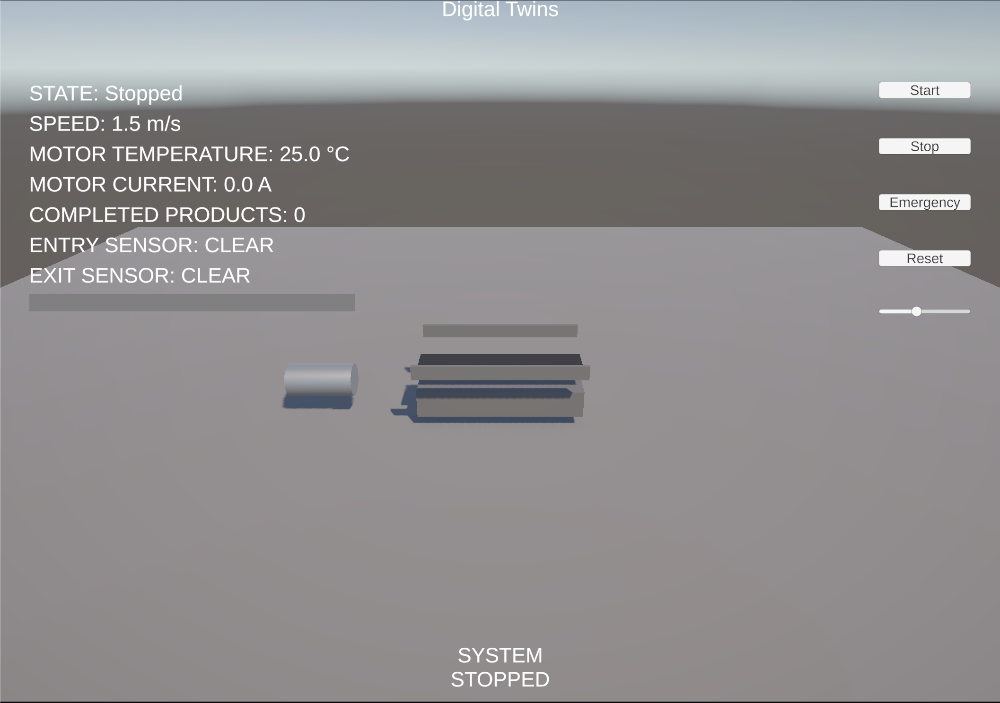
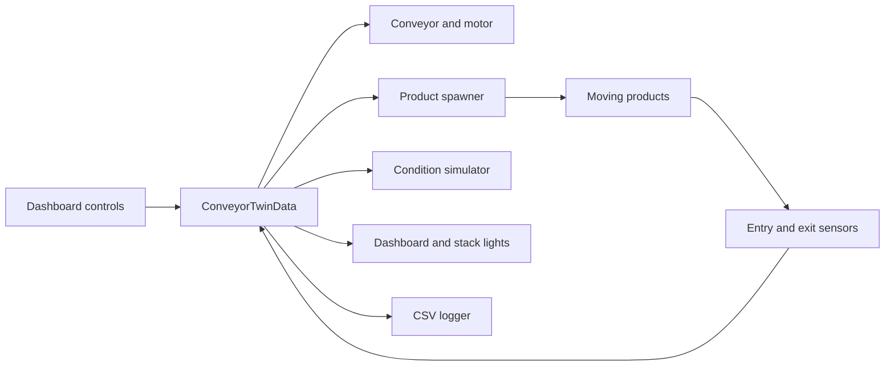
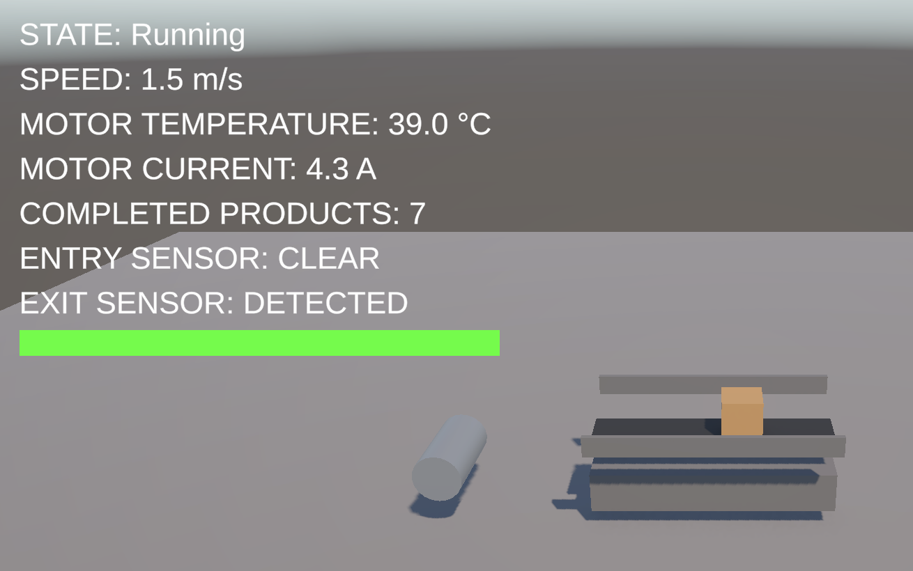
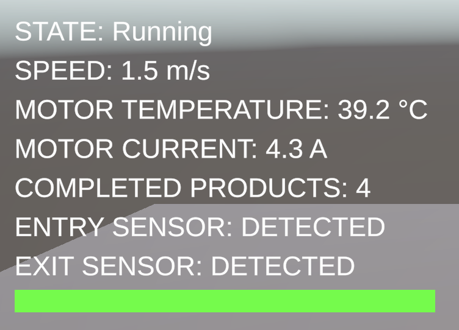
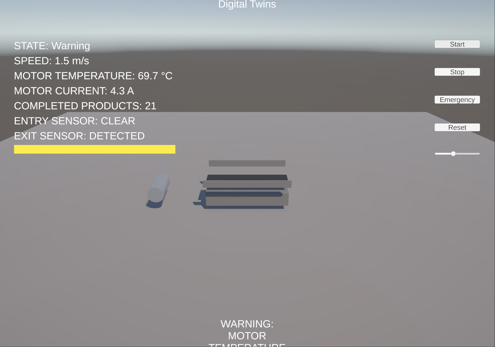

# Industrial Conveyor Digital Twin

Industrial Conveyor Digital Twin is a Unity-based operational simulation of a conveyor production line. It models product flow, virtual entry and exit sensors, machine conditions, operational state changes, a live monitoring dashboard, stack-light indicators, and CSV telemetry logging using synthetic sensor values.



## What It Does

The application simulates a small conveyor system and exposes its live operational state through an interactive dashboard. Products are spawned at a configurable interval, transported along the conveyor, detected by trigger-based virtual sensors, counted at the exit, and removed from the line. A machine-condition component generates synthetic temperature and electrical-current values and moves the system through normal, warning, fault, stopped, and emergency-stop states.

## Implemented Features

### Conveyor and product flow

- Configurable conveyor speed
- Timed product spawning with a maximum active-product limit
- Rigidbody-based product movement while the conveyor is operational
- Visible motor rotation linked to conveyor speed
- Start, stop, reset, and emergency-stop controls

### Virtual sensing and production counting

- Trigger-based entry sensor
- Trigger-based exit sensor
- Live entry/exit detection state
- Completed-product counting at the exit sensor
- Product cleanup after completion

### Synthetic machine-condition simulation

- Motor-temperature simulation
- Ambient cooling when the conveyor is not operating
- Electrical-current simulation based on conveyor speed
- Configurable warning and critical temperature thresholds
- Automatic warning and overheating-fault transitions

All temperature, electrical-current, and sensor values are simulated. They are not measurements from physical industrial equipment.

### Operational monitoring

- Live dashboard for state, speed, temperature, current, production count, and sensor status
- Normal, warning, fault, and emergency messages
- Red/yellow/green stack-light indicators
- Dashboard speed control

### CSV logging

`DigitalTwinLogger.cs` creates a timestamped CSV file and records operational data at a configurable interval. The output contains:

```text
Timestamp,State,Speed,Temperature,Current,ProductionCount,EntrySensor,ExitSensor
```

Files are written to Unity's `Application.persistentDataPath`. The logs are intended for operational review, basic analysis, demonstrations, and future experimentation. The current project provides basic operational metrics and logging; it does not implement predictive analytics.

## System Architecture



`ConveyorTwinData` is the shared operational state. Equipment, sensors, machine-condition simulation, dashboard components, indicators, and logging read from or update that state.

## Technology Stack

- Developed with Unity `6000.3.20f1`
- Runtime tested successfully with Unity `6000.3.24f1`
- C#
- Universal Render Pipeline
- Unity Input System
- TextMeshPro and Unity UI
- Rigidbody and trigger-based simulation
- CSV file output

## Project Structure

```text
Assets/
  Scenes/ConveyorDigitalTwin.unity
  Prefabs/ProductBox.prefab
  Art/Materials/
  Scripts/
    Core/
      ConveyorTwinData.cs
      SimpleCameraController.cs
    Equipment/
      ConveyorMover.cs
      MachineConditionSimulator.cs
      MotorRotation.cs
      ProductSpawner.cs
    Sensors/
      IndustrialSensor.cs
    UI/
      DigitalTwinDashboard.cs
      StackLightController.cs
    Logging/
      DigitalTwinLogger.cs
Packages/
ProjectSettings/
SampleData/
Screenshots/
```

## Running the Project

1. Open the repository with Unity `6000.3.20f1` or a compatible Unity 6000.3 editor. Runtime testing passed with Unity `6000.3.24f1`.
2. Allow Unity to resolve the packages declared in `Packages/manifest.json`.
3. Open `Assets/Scenes/ConveyorDigitalTwin.unity`.
4. Enter Play mode.
5. Use the dashboard controls to start, stop, reset, change speed, or trigger an emergency stop.
6. Inspect generated CSV files in the platform-specific location returned by `Application.persistentDataPath`.

No Python backend is required for the implemented simulation.

## Screenshots

### Conveyor operation


### Virtual sensor monitoring



### Machine monitoring dashboard



### Emergency/fault presentation



### CSV output


## Implemented Versus Future Functionality

The current repository implements the Unity conveyor simulation, synthetic virtual sensors, machine-condition logic, operational dashboard, state indicators, and CSV logging described above.

## Potential Extensions

The following are possible future additions and are **not implemented** in the current repository:

- Python services or external data processing
- Computer-vision inspection with OpenCV or MediaPipe
- AI/ML-based anomaly detection
- Predictive-maintenance models
- Advanced analytical dashboards and charts
- XR interfaces or remote assistance
- Integration with physical PLC, sensor, or industrial IoT data

## Limitations

- Sensor and machine-condition values are synthetic.
- The simulation is not connected to physical equipment or a PLC.
- CSV logging provides raw operational records rather than predictive analysis.
- No Python, computer-vision, AI/ML, predictive-maintenance, or XR runtime is included.

## Author

Dr. Ayaz Muhammad Hanif<br>
[iDeveloperz](https://ideveloperz.com)
