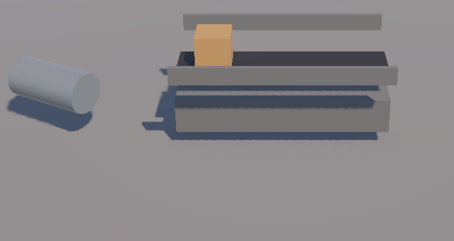
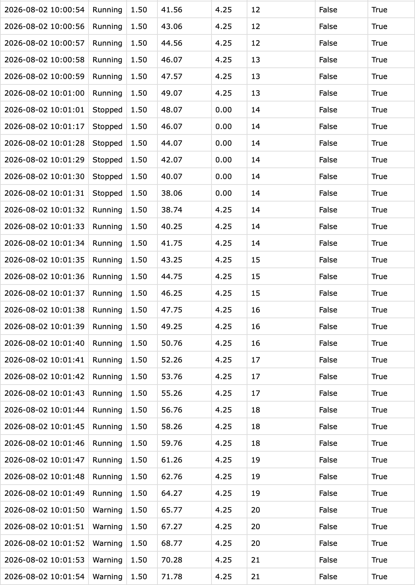

# Industrial Conveyor Digital Twin — Module 1 of the Human-Centered AI Digital Twin Platform
### AI-powered Human-Centered Digital Twin for Intelligent Industrial Monitoring, Operator Assistance, and Future XR Integration

<p align="center">

</p>

Overall view of the Industrial Conveyor Digital Twin showing the interactive monitoring dashboard and simulated production environment.


---

# Project Overview

The **Industrial Conveyor Digital Twin — Module 1 of the Human-Centered AI Digital Twin Platform** is an interactive industrial simulation platform developed in **Unity** to demonstrate how Digital Twin technologies can improve manufacturing monitoring, operator training, and future AI-assisted decision support.

The current implementation simulates a conveyor-based production system equipped with virtual industrial sensors, machine monitoring, package tracking, and operational dashboards. The project is designed as the **first module of the Human-Centered AI Digital Twin Platform**, a long-term research initiative integrating Artificial Intelligence, Computer Vision, Explainable AI, and Extended Reality (XR) for intelligent industrial environments.

Unlike conventional Digital Twins that primarily monitor machines, this research aims to develop Digital Twins capable of understanding human activities, providing explainable assistance, and supporting collaborative decision-making in Industry 5.0.

---

# Research Motivation

Manufacturing industries are rapidly adopting Digital Twins to improve operational efficiency and predictive maintenance. However, existing Digital Twins primarily focus on machine monitoring and rarely incorporate intelligent support for human operators.

This project explores how Human-Centered AI can extend Digital Twins beyond visualization by integrating real-time monitoring, Computer Vision, Explainable AI, and immersive XR interfaces to assist operators during industrial tasks.

---

# Research Vision

> To develop intelligent Human-Centered Digital Twins that combine Computer Vision, Artificial Intelligence, Explainable AI, and Extended Reality (XR) to enhance industrial monitoring, workforce training, maintenance, and collaborative decision-making.

---

# Current Features

## Industrial Conveyor Simulation

- Realistic conveyor belt simulation
- Continuous package transportation
- Adjustable conveyor operation

---

## Industrial Sensors

- Entry sensor
- Exit sensor
- Package detection
- Machine state monitoring

---

## Machine Monitoring

- Temperature monitoring
- Electrical current monitoring
- Cooling mechanism
- Machine operating status

---

## Live Dashboard

- Conveyor status
- Temperature
- Current
- Package counter
- Machine state
- Sensor status

---

## Data Logging

Operational data are automatically exported into CSV files for:

- Performance analysis
- Future AI model training
- Research experiments
- Predictive analytics

---

# System Architecture

```text
Industrial Environment
        │
        ▼
Virtual Sensors
        │
        ▼
Unity Digital Twin
        │
        ▼
Industrial Dashboard
        │
        ▼
CSV Data Logging
        │
        ▼
Future AI Modules
        │
        ▼
XR Visualization
```

---

# Technologies Used

| Category | Technologies |
|-----------|--------------|
| Engine | Unity |
| Programming | C# |
| Backend | Python |
| AI (Future) | OpenCV, MediaPipe |
| XR | Unity XR Toolkit |
| Data | CSV |
| Version Control | Git & GitHub |

---

# Repository Structure

```text
Assets/
PythonBackend/
Documentation/
Architecture/
Screenshots/
SampleData/
Research/
Media/
```

---

# Screenshots

## Industrial Conveyor

<p align="center">

</p>

Dynamic conveyor simulation demonstrating product transportation and process execution.

---

## Sensor Monitoring

<p align="center">

</p>

Virtual industrial sensors continuously monitor package movement across the production line.

---

## Machine Monitoring

<p align="center">

</p>

Real-time industrial monitoring dashboard displaying machine operating parameters.

---

## Emergency / Fault State

<p align="center">

</p>

Emergency stop mode illustrating abnormal operating conditions within the Digital Twin.

---

## CSV Logging

<p align="center">

</p>

---

# Research Platform

This project is the first implementation of the

# Human-Centered AI Digital Twin Platform

Future modules include

- AI Motion Analysis
- Human Pose Estimation
- Computer Vision Inspection
- Explainable AI Dashboard
- XR Remote Assistance
- Predictive Maintenance
- Human-Robot Collaboration

---

# Research Roadmap

## Phase 1 (Completed)

Industrial Conveyor Digital Twin — Module 1 of the Human-Centered AI Digital Twin Platform

---

## Phase 2 (In Progress)

Computer Vision Integration

---

## Phase 3

AI-based Skill Assessment

---

## Phase 4

Explainable AI

---

## Phase 5

Extended Reality Integration

---

## Phase 6

Human-Robot Collaboration

---

# Industrial Applications

- Smart Manufacturing
- Industry 4.0
- Industry 5.0
- Predictive Maintenance
- Operator Training
- Industrial Simulation
- Human-AI Collaboration

---

# Installation

1. Clone the repository

```bash
git clone https://github.com/Dr-AMH/IndustrialConveyorDigitalTwin.git
```

2. Open the project in Unity.

3. Run the Python backend (if required).

4. Open the Conveyor scene.

5. Press Play.

---

# Future Research

This repository is continuously evolving toward a Human-Centered AI platform integrating

- Computer Vision
- Explainable AI
- Vision-Language Models
- XR Interfaces
- Intelligent Digital Twins
- Embodied AI

---

# About the Author

**Dr. Ayaz Muhammad Hanif**

Research Engineer | Human-Centered AI | Computer Vision | Extended Reality | Digital Twins

Website:
https://ideveloperz.com

GitHub:
https://github.com/Dr-AMH

---

# Citation

CITATION.cff

---

# License

This project is released under the MIT License.

---

# Acknowledgements

This project reflects ongoing research in Human-Centered AI, Digital Twins, and XR systems and forms part of a broader research agenda focused on intelligent industrial technologies and Industry 5.0.