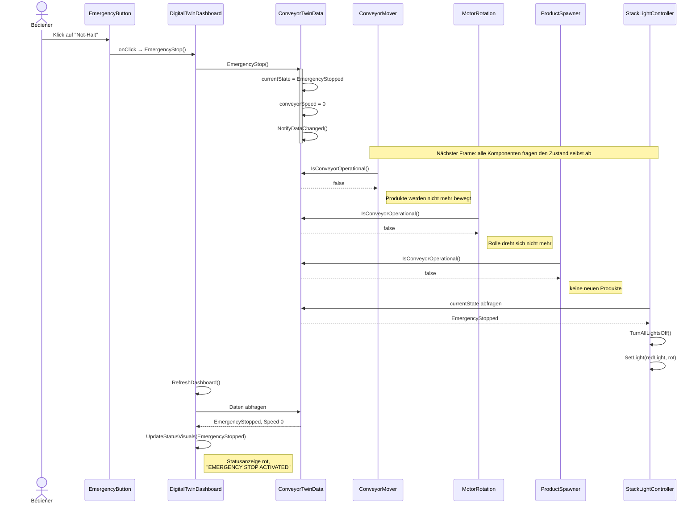

# Industrial Conveyor Digital Twin

## Funktionen

### Start

*Start* bringt den Zylinder auf der linken Seite zum drehen, was die Produktion startet wobei nach und nach, bei konstanter Geschwindigkeit, das Produkt über das Rollband wandert.

### Stop

*Stop* hält den Zylinder an und somit auch das Fließband und das Produkt darauf. Es gibt hierbei keine Verrutschungen oder ähnliches.  

### Reset

*Reset* setzt sowohl die Förderbandgeschwindigkeit auf den Normalwert zurück als auch die restlichen Produktionseinstellungen. 

### Not-Halt

*Emergeny/Not-Halt* stoppt den Produktionskreislauf, mit dem Unterschied zu Stop, das man zuerst reseten muss um es wieder neu starten zu können. 

### Fördergeschwindigkeit verändern

Bei dem verändern der *Förderbandgeschwindigkeit* schlägt das Förderband fehl und das Produkt bleibt am linken Ende/ Anfang des Förderbands stecken. Sollte ein neues kommen, schlägt es das andere einfach weg, welches darauf hin weg fliegt.

### Temperaturüberwachung

Die *Temperaturüberwachung* ist nicht zu sehen, da sie weiß auf weißem Hintergrund ist. Dadurch hat man keine Informationen.

### Zusätzliches

--

## Programmstruktur

1. ConveyorMover
2. IndustrialSensor
3. ConveyorTwinData
4. DiigtalTwinLogger

## Einordnung in virtuell Engineering

1. Förderband mit Rahmen und Seitenführungen, Antriebsmotor, Werkstücke, Einlauf- und Auslaufsensor, Signalampel (Stack Light), Bedienpult (Start, Stop, Reset, Not-Halt, Geschwindigkeit) und Leitstand-Dashboard.
2. Hallenboden (FactoryFloor), Bandrahmen, Seitenführungen (Left/RightRail), das Band selbst als Fläche und das Gehäuse der Ampel. Diese Teile sind nur Form ohne eigenes Verhalten.
3. Teile mit simuliertem Verhalten:

- Transport der Werkstücke mit Physik (Rigidbody)
- Erkennung durch die Sensoren (Trigger)
- Erzeugen und Zählen der Produkte
- Erwärmung, Abkühlung und Stromaufnahme des Motors
- Zustandsautomat (Stopped, Running, Warning, Fault, Not-Halt) mit Sperren und Reset-Pflicht
- Ampel und Alarmmeldungen
Datenprotokoll
4. Vorteile bei der Entwicklung einer realen Anlage:

- Man kann Steuerungslogik und Abläufe testen, bevor es Hardware gibt (virtuelle Inbetriebnahme).
- Fehler fallen früh und günstig auf.
- Gefährliche Situationen wie Überhitzung oder Not-Halt lassen sich gefahrlos durchspielen.
- Parameter wie Geschwindigkeit, Takt und Grenzwerte könnt ihr optimieren.
- Bediener können geschult werden.
- Die protokollierten Daten lassen sich auswerten, zum Beispiel als Grundlage für vorausschauende Wartung.
5. Was noch fehlt um eine reale Anlage zu verbinden: 

- Eine Kommunkiktionsschnittstelle
- Eine Signalliste mit Variablen(Adressen, Node-IDs, Lese- und Schreibberechtigungen, etc)
- Echte Sensordaten
- Echte Kenndaten
- Ein Sicherheitskonzept(Not-Aus muss auch von der Hardware aus laufen, nicht nur in Unity)
- Regeln für Netzwerk, Zugriff, etc

## UML-Sequenzdiagramm: Not-Halt auslösen (Ablauf C)

### Beteiligte Objekte

| Objekt | Aufgabe im Ablauf |
|---|---|
| Bediener | drückt den Not-Halt-Button |
| EmergencyButton (UI Button) | löst sein `onClick`-Event aus |
| DigitalTwinDashboard | nimmt den Klick an und leitet ihn an die Steuerung weiter, zeigt danach den Status an |
| ConveyorTwinData | zentrale Steuerung/Datenhaltung, ändert den Betriebszustand |
| ConveyorMover | bewegt die Produkte auf dem Band |
| MotorRotation | dreht die Antriebsrolle |
| ProductSpawner | erzeugt neue Produkte |
| StackLightController | schaltet die Signalampel |

### Diagramm

### Zeitliche Reihenfolge

1. Der Bediener klickt auf den Not-Halt-Button. Der Button ruft über sein `onClick`-Event `DigitalTwinDashboard.EmergencyStop()` auf.
2. Das Dashboard gibt den Aufruf an `ConveyorTwinData.EmergencyStop()` weiter.
3. `ConveyorTwinData` setzt den Zustand auf `EmergencyStopped`, die Geschwindigkeit auf `0` und ruft `NotifyDataChanged()` auf.
4. Im nächsten Frame fragen `ConveyorMover`, `MotorRotation` und `ProductSpawner` mit `IsConveyorOperational()` nach, ob die Anlage läuft. Die Antwort ist `false`, also stoppen Band, Motor und Produktion.
5. Der `StackLightController` liest den Zustand und schaltet nur die rote Lampe ein.
6. Das Dashboard aktualisiert in `RefreshDashboard()` die Texte und setzt in `UpdateStatusVisuals()` die Statusanzeige auf Rot mit der Meldung "EMERGENCY STOP ACTIVATED".

Die Komponenten werden nicht direkt von `ConveyorTwinData` benachrichtigt. Das Event `DataChanged` hat keine Abonnenten, stattdessen fragt jede Komponente in ihrem eigenen `Update()`/`FixedUpdate()` den Zustand ab (Polling). Wieder starten geht erst nach `ResetMachine()`, weil `StartMachine()` im Zustand `EmergencyStopped` abbricht.